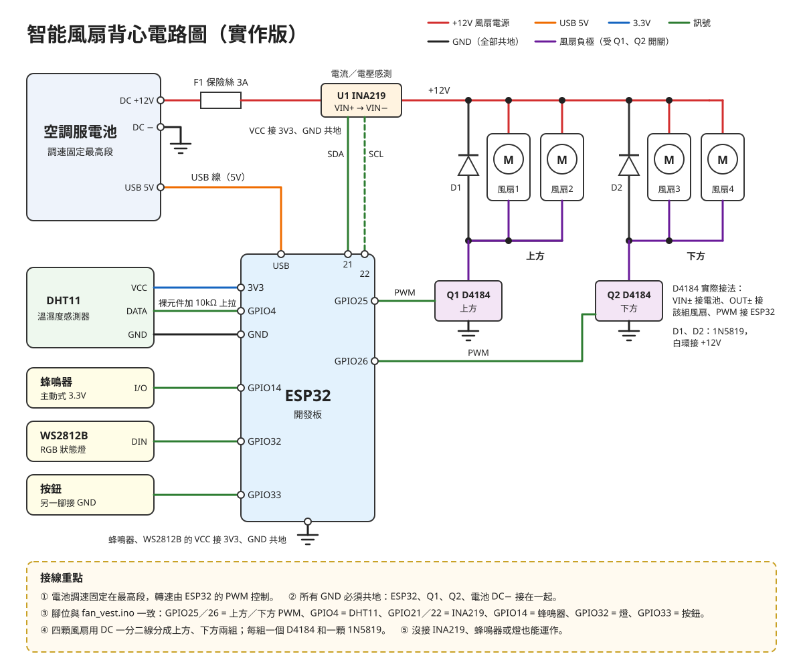

# 溫控風扇背心

把市售空調服（12V 電池、四顆風扇）改裝成**依體感溫度自動調速**的風扇背心，用手機**藍牙**控制。

- **體感溫度控制**：DHT11 同時量溫度與濕度，依熱指數調速，悶熱潮濕時自動吹更強
- **上方、下方分區**：兩組風扇各自 PWM 調速；自動模式下方可設定加強，手動模式兩區分開調
- **遲滯控制**：28°C 啟動、降到 26°C 以下才停止，避免風扇在門檻附近反覆開關
- **中暑警示**：體感溫度過高時，蜂鳴器響、狀態燈閃紅、手機跳出警告並震動
- **電源監測**（INA219）：電流、電壓、功率、電池電量估算、本次耗電；超過 3A 自動停止風扇，風扇沒接好也會提醒
- **低電量省電**：電量低於 20% 時限制最高風速 70%，延長使用時間
- **設定記憶**：溫度門檻、警示溫度、模式與風速存在 ESP32，重新開機也不會消失
- **實體按鈕＋RGB 狀態燈**：沒帶手機也能切換模式，燈色顯示溫度等級與警示
- **藍牙配對碼**：避免旁人連上你的背心
- **故障安全**：溫濕度感測器失效時以 70% 安全轉速運轉，不會停止散熱
- 手機用瀏覽器直接連線，免安裝 App；開過一次後離線也能使用，連線時螢幕保持亮著

## 專案結構

```
firmware/fan_vest/fan_vest.ino   ESP32 韌體（BLE）
docs/                            手機控制頁（GitHub Pages）
hardware/circuit.svg             接線圖
```

## 材料

| 元件 | 規格 | 數量 |
|---|---|---|
| 微控制器 | ESP32 DevKit（ESP32-WROOM-32） | 1 |
| 溫濕度感測器 | DHT11 模組（可換 DHT22，改一行設定） | 1 |
| 電流／電壓感測 | INA219 模組（0.1Ω 分流電阻，最大約 3.2A） | 1 |
| MOSFET 驅動模組 | D4184 | 2 |
| 蕭特基二極體 | 1N5819 | 2 |
| 保險絲 | 3A 自恢復保險絲 | 1 |
| 蜂鳴器 | 主動式 3.3V 模組 | 1 |
| RGB 狀態燈 | WS2812B 單顆模組 | 1 |
| 按鈕 | 12mm 輕觸按鈕 | 1 |
| DC 一分二線 | 5.5×2.1，一母轉二公 | 2 |
| DC 轉接線 | 5.5×2.1 公＋母 | 1 組 |
| USB 線 | 電池 USB 孔 → ESP32（要能傳資料） | 1 |

## 接線



| ESP32 | 接到 |
|---|---|
| GPIO25 | 上方 D4184 PWM |
| GPIO26 | 下方 D4184 PWM |
| GPIO4 | DHT11 DATA（裸元件另接 10kΩ 到 3.3V） |
| GPIO21 / 22 | INA219 SDA / SCL |
| GPIO14 | 蜂鳴器 |
| GPIO32 | WS2812B DIN |
| GPIO33 | 按鈕（另一腳接 GND） |
| 3V3 | DHT11、INA219、蜂鳴器、WS2812B 的 VCC |
| GND | 所有模組 GND、兩個 D4184 的 GND |
| USB | 電池 USB 輸出孔 |

- 電池 DC 12V → 保險絲 → INA219 VIN+ → VIN− → 兩個 D4184 模組 → 上方、下方風扇
- 1N5819 並聯在每組風扇兩端，白環（陰極）接 +12V
- 電池調速固定在**最高段**，轉速由 ESP32 控制
- DHT11 放在背心內側、不會被汗水直接滴到的位置，用透氣布包著，不要用熱縮套管包死
- 所有 GND 必須共地
- 沒接 INA219、蜂鳴器或狀態燈也能正常運作

## 燒錄韌體

1. Arduino IDE 安裝 ESP32 開發板（**core 3.x**）
2. 程式庫管理員安裝 `DHT sensor library`、`Adafruit Unified Sensor`、`Adafruit INA219`、`Adafruit NeoPixel`
3. 開啟 `firmware/fan_vest/fan_vest.ino`，開發板選 **ESP32 Dev Module**，上傳

程式開頭的常數可以調整：

| 常數 | 說明 |
|---|---|
| `DHT_TYPE` | 改成 `DHT22` 就能換感測器，接線相同 |
| `BLE_PIN` / `BLE_USE_PIN` | 藍牙配對碼（預設 123456）／是否啟用 |
| `DUTY_MIN` | 風扇最低可轉動的轉速，請實測後調整 |
| `OVERCURRENT_MA` / `FAN_MIN_MA` | 過電流門檻／風扇斷線判斷電流 |
| `BATT_EMPTY_MV` / `BATT_FULL_MV` | 電池空電、滿電電壓，用來估算電量 |

溫度門檻、中暑警示溫度、下方加強、蜂鳴器開關則在手機的「設定」裡調整。

> **電量估算**：預設以 3 串鋰電池（10.2–12.6V）換算。如果你的電池輸出是穩壓 12V（滿電和快沒電時電壓都差不多），電量顯示會一直接近 100%，這時請以電池本身的電量燈為準。可以在滿電和快沒電時各看一次手機上的電壓來確認。

## 實體按鈕與狀態燈

| 操作 | 功能 |
|---|---|
| 短按 | 自動 → 手動 30% → 60% → 100% → 關閉 → 自動 |
| 長按 1.5 秒 | 靜音中暑警報、解除過電流保護 |

| 燈號 | 意思 |
|---|---|
| 藍／黃／橘／紅 | 自動模式，依溫度等級變色 |
| 白 | 手動模式 |
| 紫 | 溫濕度感測器異常 |
| 紅色慢閃 | 中暑警示 |
| 紅色快閃 | 過電流保護，風扇已停止 |
| 每 4 秒閃一下黃 | 低電量 |

## 手機控制

開啟控制頁：**https://youenc120-ux.github.io/smart-fan-vest/**

1. 打開背心電源與手機藍牙
2. 點「連線裝置」，選擇 **FanVest**
3. 第一次連線會要求輸入配對碼（預設 **123456**）
4. 切換自動／手動，手動模式分別拖曳上方、下方滑桿

| 平台 | 支援 |
|---|---|
| Android Chrome | ✅ |
| 電腦版 Chrome／Edge | ✅ |
| iPhone | 需改用 [Bluefy](https://apps.apple.com/app/bluefy-web-ble-browser/id1492822055) 瀏覽器（Safari 不支援 Web Bluetooth） |

在網址後面加上 `?demo` 可以不接硬體、用模擬資料預覽介面。

建議在 Chrome 選單選「加到主畫面」，之後像 App 一樣開啟。

> 從舊版韌體升級後如果連不上，請到手機的藍牙設定把「FanVest」取消配對，再重新連線。

## BLE 介面

服務 UUID `7a1e0001-5c2b-4f0a-9d3e-6b8f2a4c9e10`，所有數值 little-endian，詳細欄位見 `fan_vest.ino` 開頭註解。

| 特徵值 | UUID 尾碼 | 屬性 | 內容 |
|---|---|---|---|
| STATUS | `…0002…` | 讀取、通知 | 20 bytes：溫度、濕度、體感溫度、上下轉速、模式、手動設定、電壓、電流、電量、狀態旗標、耗電、開機時間 |
| CONTROL | `…0003…` | 寫入 | 3 bytes：自動模式、手動上方%、手動下方%（也會靜音警報、解除過電流保護） |
| CONFIG | `…0004…` | 讀取 | 9 bytes：最低轉速、故障安全轉速、過電流門檻、電池空滿電壓、低電量轉速上限 |
| SETTINGS | `…0005…` | 讀取、寫入 | 11 bytes：T0／T1／T2、下方加強、中暑警示溫度、蜂鳴器、依體感溫度控制 |

狀態旗標：`0x01` 找不到 INA219、`0x02` 過電流保護、`0x04` 風扇電流過低、`0x08` 中暑警示、`0x10` 低電量、`0x20` 警報已靜音。
